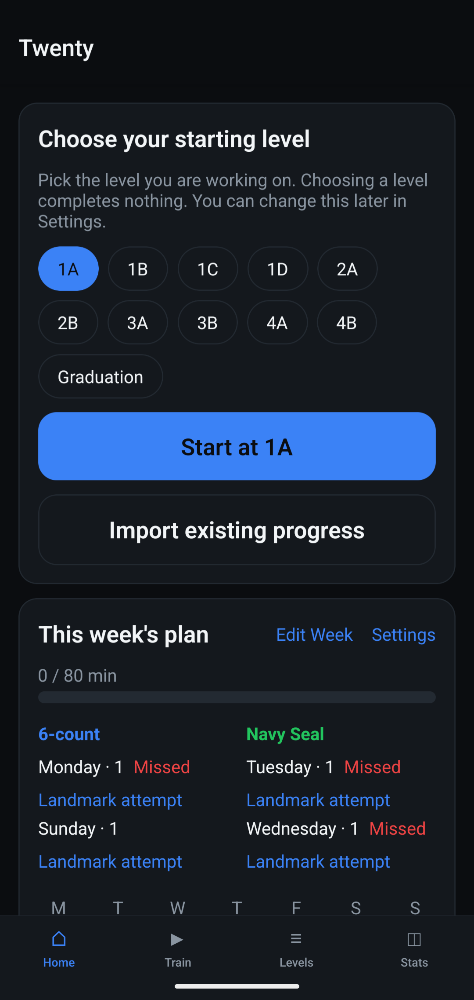
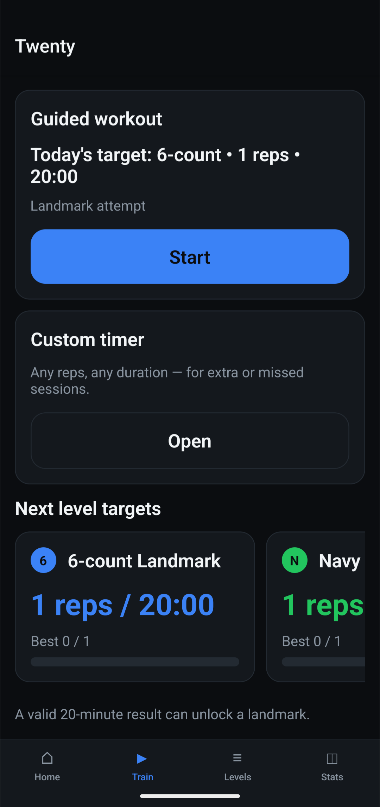
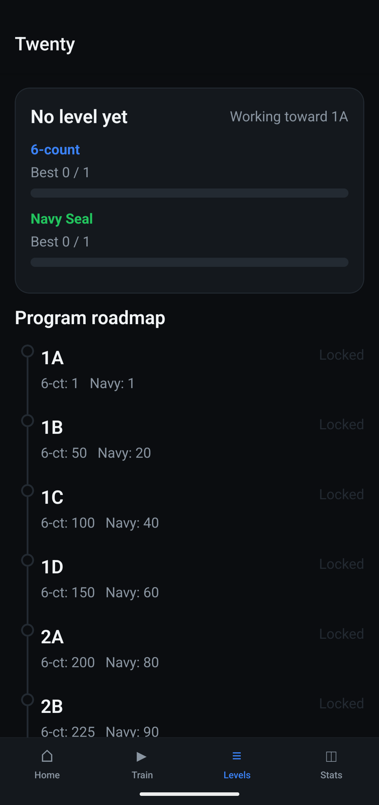
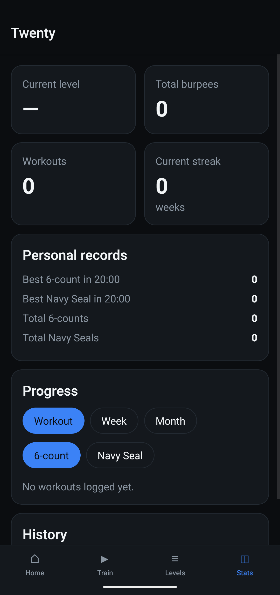
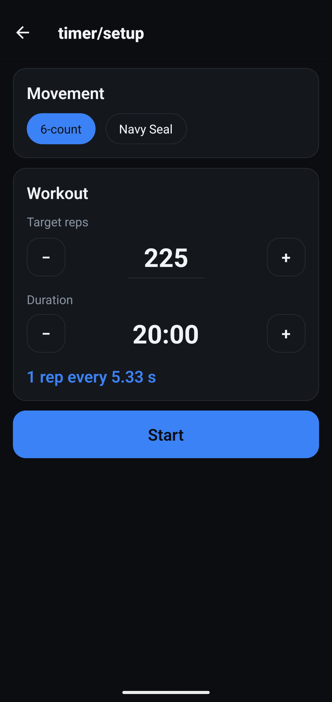
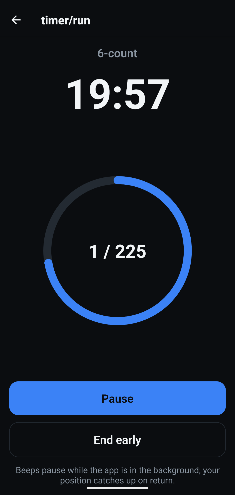
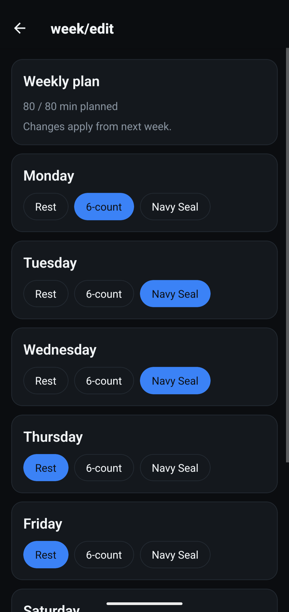
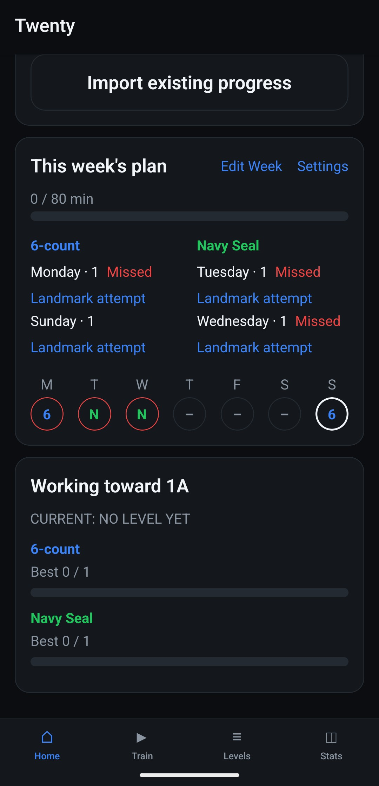
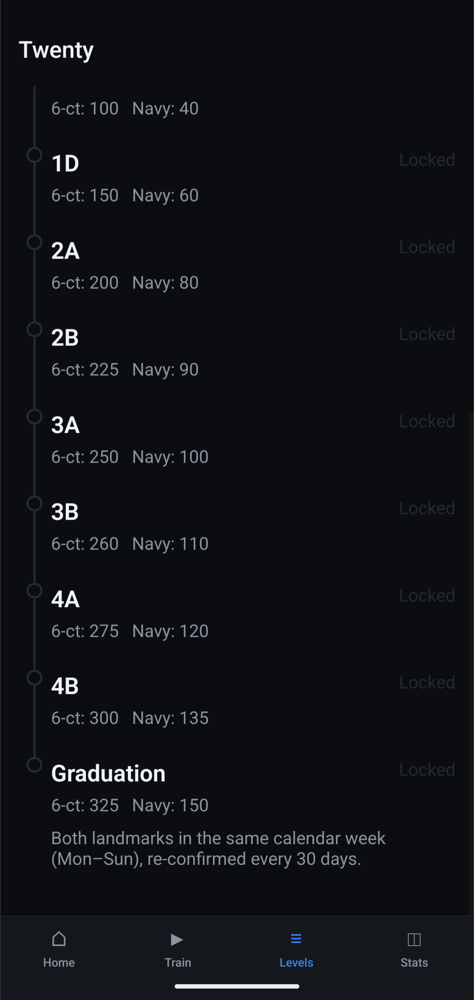
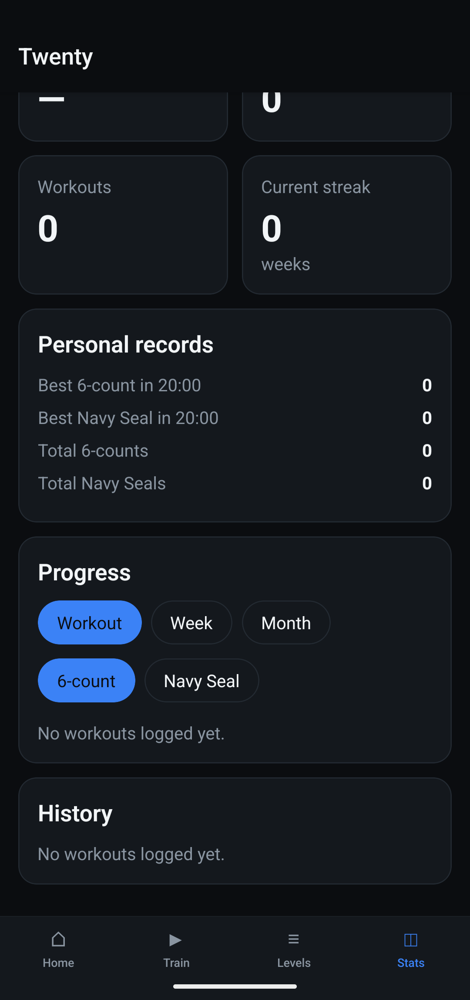

# Twenty

[](https://github.com/CryptoRodeo/twenty/releases/latest)
[](LICENSE)

A personal, offline burpee training tracker: an 11-level program, a pacing
timer that beeps once per rep, a roadmap, and progress stats. Single user, no
accounts, no backend, no network calls. Original app, not affiliated with any
commercial training program.

**Android only.** There is no iOS release, and none is planned for now.

<p align="center">
  
  
  
  
</p>
<p align="center">
  
  
  
</p>

<details>
<summary>More screenshots</summary>
<p align="center">
  
  
  
</p>
</details>

## Install

Android only. The latest `.apk` is on the [releases page](https://github.com/CryptoRodeo/twenty/releases/latest).

To get updates automatically, use [Obtainium](https://github.com/ImranR98/Obtainium):
tap **Add App**, paste `https://github.com/CryptoRodeo/twenty`, then **Add** and
**Install**. Obtainium checks this repo's Releases and offers each new version.

Your phone will ask you to allow installs from Obtainium (or your browser, if
you downloaded the `.apk` directly) the first time.

Publishing a new version is covered in [docs/releasing.md](docs/releasing.md).
Which file owns which rule or setting is listed in [docs/areas.md](docs/areas.md).

## Run it

Needs Node 22 (pinned in `.nvmrc`; with nvm, run `nvm use`).

```bash
npm install
npx expo start
```

Then open the project in Expo Go on a phone, or build a dev client. Dark theme
only. The code is Expo and may run on iOS from source, but only Android is
built, released and tested.

## Tests

```bash
npm test          # Jest: domain, data, store, components, screens
npm run typecheck # tsc --noEmit, strict
```

The domain layer (`src/domain/`) is pure and carries the bulk of the tests:
level unlocks, graduation rules, planner adjustments and timer math.

## Starting out

A new install starts as a beginner. On the Home screen you choose the level you
are working on (or import existing progress). Choosing a level completes
nothing; it only sets what you are aiming at. You can change it any time in
Settings. Once you actually hit a level's targets, that level and every level
below it count as completed.

## Rules this app implements

- A **landmark** is a session of exactly **20:00** whose completed reps reach
  that level's target for that movement. Sessions of any other length count
  toward stats and totals but can never unlock a landmark.
- A level is **reached** when both of its landmarks are met, in any order,
  across any sessions. One big result can unlock several levels at once, and
  reaching a level completes all lower levels.
- **Graduation** additionally requires both landmarks in the **same Mon-Sun
  week**, and must be re-confirmed within **`GRADUATION_VALID_DAYS`** days
  (`src/domain/levels.ts`) or the level drops back
  to 4B. History is kept either way.
- **Streak** = consecutive Mon-Sun weeks, counting back from this week (or
  last week if this week has not reached the goal yet), in which logged
  minutes meet the weekly goal. An imported streak is added when the chain
  runs back past the first logged session.
- **Weekly targets** move by the rules in `src/domain/planner.ts`: a small bump
  after hitting the target (smaller if it felt hard), flat at maximum effort
  or a near miss, and a back-off after missing by more than 5%. A missed
  session never stacks. When a target reaches the next landmark, that day
  becomes a **Landmark attempt**. A week opens with the first-week rule (`FIRST_WEEK_FRACTION`
  of the next landmark, or your best if higher) when you choose a level,
  import progress, or after a level-up; adjustment continues from there.
  Changing your level (or importing progress) mid-week resets the rest of the
  current week, and the next week also starts from the new level.
- **Edit Week** changes the layout from the **following** week; an existing
  planned week is never overwritten.
- **Backup**: Settings can export everything as JSON and restore it later.
  Restoring replaces all current data, after a confirmation.

## File formats

### Past-session CSV (Import screen)

One session per line, header optional. Rules: dates are real `YYYY-MM-DD`
days (stored as 12:00 local time); movement accepts `6`, `six`, `6-count`,
`N`, `navy`, `navy seal` and similar; duration is in minutes; reps is a whole
number of 0 or more; effort is 1-10 or blank. Only a row of exactly 20
minutes can count as a landmark; any other length counts toward totals and
stats only.

```csv
date,movement,durationMin,reps,effort
2026-09-01,6-count,20,100,7
2026-09-03,six,20,105,
2026-09-05,N,20,42,8
2026-09-07,navy seal,15,30,6
```

### JSON backup (Settings)

Export produces this shape and Restore accepts it. Restoring replaces all
current data. This trimmed example is valid as written.

```json
{
  "version": 1,
  "exportedAt": "2026-10-07T12:00:00.000Z",
  "sessions": [
    {
      "id": "s1",
      "movement": "SIX_COUNT",
      "startedAt": "2026-10-05T06:00:00.000Z",
      "durationSec": 1200,
      "targetReps": 100,
      "completedReps": 104,
      "effort": 7,
      "kind": "LANDMARK"
    }
  ],
  "planned": [
    {
      "id": "p1",
      "weekStart": "2026-10-05",
      "dayOfWeek": 0,
      "movement": "SIX_COUNT",
      "targetReps": 100,
      "isTestDay": false,
      "sessionId": "s1"
    }
  ],
  "levelEvents": [],
  "settings": {
    "weeklyGoalMin": 80,
    "planDays": [
      { "dayOfWeek": 0, "movement": "SIX_COUNT" },
      { "dayOfWeek": 1, "movement": "NAVY_SEAL" }
    ],
    "soundOn": true,
    "hapticsOn": true,
    "countInSec": 10,
    "targetLevelOrder": 0,
    "restartWeek": null
  },
  "baseline": null
}
```

`kind` is `GUIDED`, `CUSTOM` or `LANDMARK`; `effort` is `null` or 1-10.
`restartWeek` (optional) is `null` or the Monday (`YYYY-MM-DD`) of the week you
last chose a level or imported progress.

## Known limitation

Rep beeps do not play while the app is in the background; Expo cannot
reliably schedule audio at sub-5-second intervals there. Workout position is
recomputed from timestamps when the app returns to the foreground, so the
count and clock stay correct; only the sound pauses.

## License

Copyright (C) 2026 Bryan Ramos

Twenty is free software: you can redistribute it and/or modify it under the
terms of the GNU General Public License as published by the Free Software
Foundation, either version 3 of the License, or (at your option) any later
version. See [LICENSE](LICENSE).

In short: you may use, change and even sell it, but anything you distribute
that is based on it must keep this notice, credit the original, and ship its
full source code under the same license.
